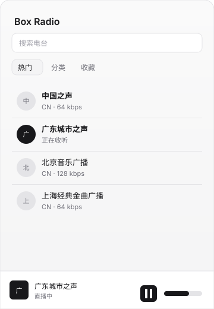
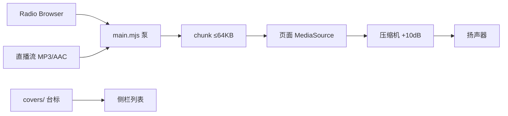

#  Box Radio

<p align="center">
  
</p>

EnsoCode 侧栏插件。在会话右边栏里浏览、搜索、收藏并收听互联网电台。

当前版本 **0.3.2** · 数据源 [Radio Browser](https://api.radio-browser.info/)（免 key）· 只播 HTTP MP3 / AAC 直播流。

| | |
| --- | --- |
| 热门 / 分类 / 收藏 | 默认中国热门；分类按地区；收藏存在插件 storage |
| 搜索 | 不限国家，支持别名（如 快乐888 → 中山環保旅遊之声） |
| 播放 | `main` 拉流分块，侧栏 MediaSource 播，切台先灌第一包再 `play()` |
| 音量 | 滑条 0–1，前面串压缩机和 +10dB 上限 |

## 安装

1. EnsoCode → 设置 → 插件 → Enso plugins
2. 从文件夹安装本仓库，或从 GitHub 安装 [boxpiggy/box-radio](https://github.com/boxpiggy/box-radio)
3. 启用 **Box Radio**
4. 会话右侧栏「+」→ Box Radio

从 Git 安装前在本目录执行 `npm ci`。改完代码后，插件行点「从来源重新安装」。

## 怎么播



侧栏页跑在 `sandbox="allow-scripts"` 里，不能自己联网，也不能 `<audio src="https://...">`。音频和图都由 `main` 代拉，经 `enso.call` 回页面。

## 开发

```bash
node --test
node scripts/fetch-covers.mjs   # 刷新 covers/（CN 目录 favicon，单张 ≤40KB）
```

| 路径 | 作用 |
| --- | --- |
| `enso-plugin.json` | 插件清单，id `box.radio` |
| `main.mjs` | 目录、拉流、台标 |
| `ui.js` / `index.html` | 侧栏 |
| `covers/` | 打包台标，`manifest.json` 按 Radio Browser uuid 映射 |
| `icon.svg` | 设置页 / 侧栏标签图标（Lucide radio） |

许可证 [MIT](LICENSE)。图标来自 [Lucide](https://lucide.dev/icons/radio)（ISC）。
